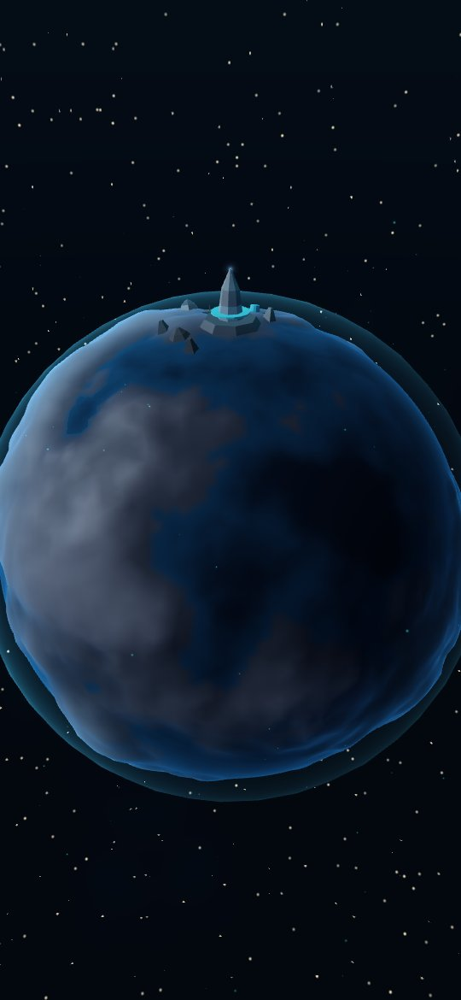
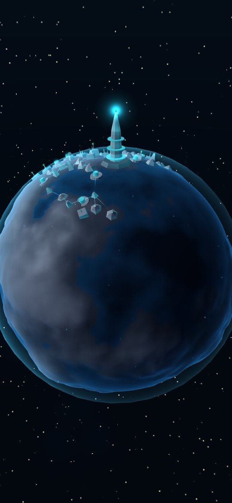
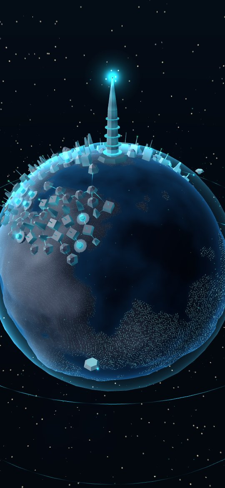
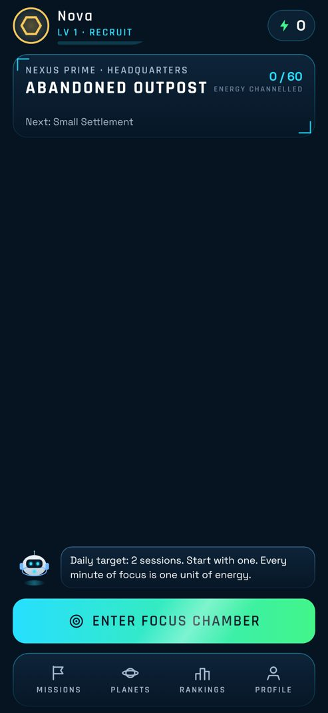
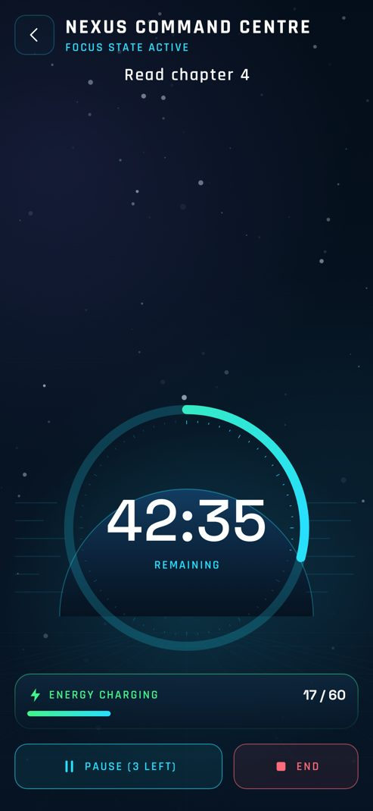
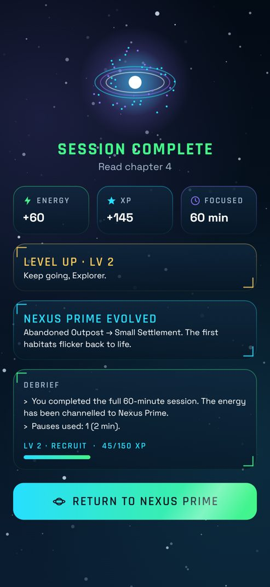

# NEXUS

**YOUR FOCUS. YOUR UNIVERSE.**

NEXUS is an Android focus app wrapped in a sci-fi civilization-building game. Real-world focus sessions generate energy, and that energy restores a 3D planet that visibly grows as you stay consistent.

> FOCUS → EARN → BUILD → EXPLORE → COMPETE → EVOLVE

Status: **Milestone 1, first playable MVP.** See [DEVELOPMENT_ROADMAP.md](DEVELOPMENT_ROADMAP.md).

| Abandoned outpost | Research colony | Planetary civilization |
|---|---|---|
|  |  |  |

| Home | Focus Chamber | Debrief |
|---|---|---|
|  |  |  |

*3D renders come from the headless shader harness, and UI captures from the Robolectric journey test. The test swaps the GL view for a fake, so the 3D area is empty in UI captures.*

## What works today

- **A reliable focus timer.** It's timestamp-based and survives backgrounding, process death and reboots. It ignores clock changes and tracks pauses. It needs no foreground service and works fully offline.
- **A duplicate-proof reward economy.** One energy per focused minute, XP, levels, ranks and forgiving streaks, all with a healthy-play limiter.
- **A living 3D Nexus Prime** (native OpenGL ES 3.0). The civilization grows continuously across 5 stages, with an energy pulse on reward and an orbit/zoom camera, in LOW/MEDIUM/HIGH quality tiers.
- **The full first-run flow:** cinematic intro, guest registration, AIRA/VYON/ORION introduction, home HUD, Focus Chamber with 4 environments, debrief, profile stats and settings.

## Build

Requirements: JDK 17+ and the Android SDK (platform 36, build-tools 36).

```bash
echo "sdk.dir=/path/to/Android/sdk" > local.properties
```

```bash
./gradlew :app:assembleDebug
```

```bash
./gradlew :core:domain:test :world:scene:test :core:data:testDebugUnitTest :app:testDebugUnitTest
```

Install on a connected device:

```bash
./gradlew :app:installDebug
```

## Documentation

| Doc | Contents |
|---|---|
| [ARCHITECTURE.md](ARCHITECTURE.md) | Modules, data flow, engine boundary, schema |
| [TECHNICAL_DECISIONS.md](TECHNICAL_DECISIONS.md) | Unity vs Godot evaluation and recommendation, and the other decision records |
| [GAME_DESIGN.md](GAME_DESIGN.md) | Story, characters, worlds, economy, rules, planned systems |
| [ART_DIRECTION.md](ART_DIRECTION.md) | Colour, type, UI language, character identity rules |
| [ASSET_PIPELINE.md](ASSET_PIPELINE.md) | Placeholder inventory, budgets, licensing |
| [TESTING.md](TESTING.md) | Automated suites, render harness, device test plan |
| [DEVELOPMENT_ROADMAP.md](DEVELOPMENT_ROADMAP.md) | Milestones, progress tracker, known issues |

## Licences

Code: all rights reserved by the project owner unless stated otherwise. Fonts: SIL OFL 1.1 (`licenses/`). All other assets are original.
